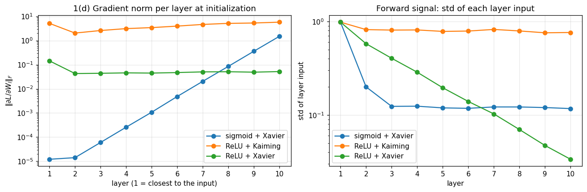
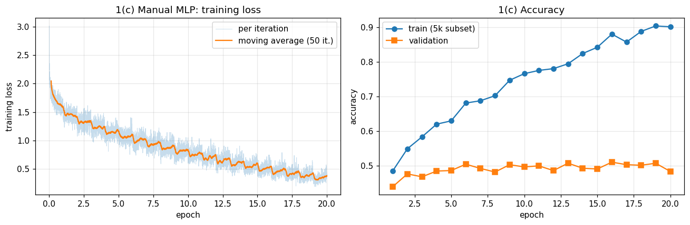
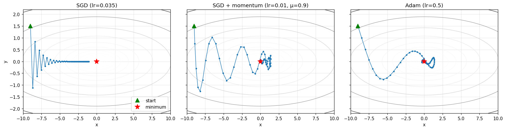
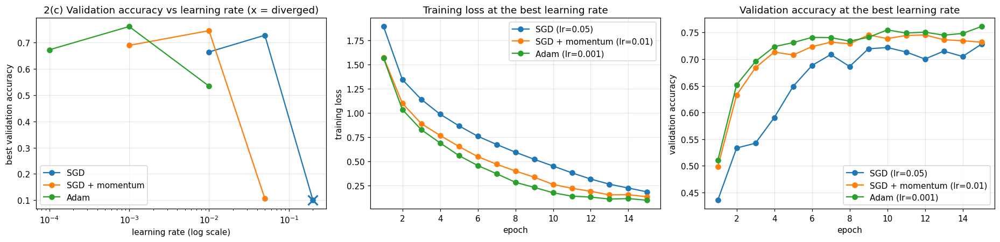
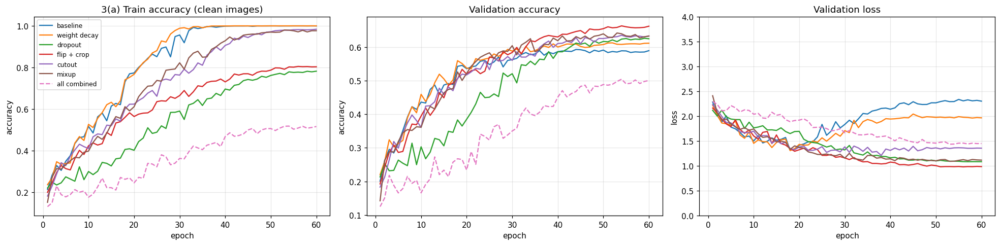
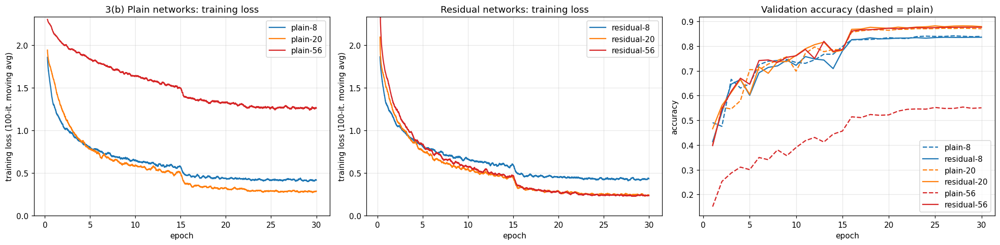
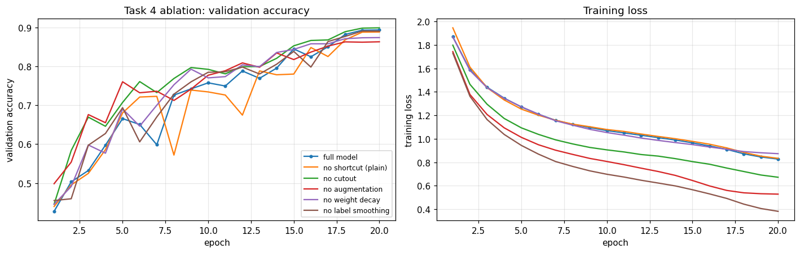

# EN4554 Assignment 2: CNNs on CIFAR-10

<p>
  <a href="https://colab.research.google.com/github/KaveeshwaraBandara/EN4554-A2-CNNs-CIFAR10/blob/main/220059J_a02.ipynb"></a>
  
  
  
</p>

Coursework for **EN4554 Deep Learning for Vision**, University of Moratuwa.
**Author:** Imanchana Kaveeshwara Bandara (220059J)

This project works through how deep networks are trained, from the ground up:

1. **Backpropagation from scratch:** linear, ReLU, sigmoid and softmax-cross-entropy layers with hand-written backward passes, checked against autograd and finite differences.
2. **Optimizers:** SGD with momentum and Adam written as `torch.optim.Optimizer` subclasses, compared on a toy problem and on a real CNN.
3. **Regularization and residual connections:** weight decay, dropout, flip + crop, cutout and mixup on a 5k-image subset, then plain vs residual networks at depths 8, 20 and 56.
4. **Best CNN under a budget:** at most 500k parameters and 20 epochs, with an ablation study.

Everything is in a single notebook: [`220059J_a02.ipynb`](220059J_a02.ipynb).

## Results at a glance

| Experiment | Result |
|---|---|
| Manual backprop vs autograd (float64) | relative error ≤ 1.5 × 10⁻¹⁶ |
| MLP from scratch, flattened pixels | 48.3 % validation accuracy (best 51.0 %) |
| Small CNN, best optimizer (Adam, lr 1e-3, 15 epochs) | 76.1 % validation accuracy |
| Best single regularizer on 5k images (flip + crop) | 66.2 % vs 58.9 % baseline |
| Plain-56 vs plain-20, final training loss | **1.256 vs 0.283** (degradation problem) |
| Residual-56 vs residual-20, final training loss | 0.237 vs 0.243 |
| Final model (393k params, 20 epochs) | **89.95 % test accuracy** |

## Task 1: Backpropagation

The custom layers match PyTorch's autograd to float64 machine precision. Centred finite differences agree to 10⁻⁷ or better.

**Gradient norm per layer at initialization (10-layer MLP).** With sigmoid, the gradient shrinks by about 0.25× per layer going backwards, so the first layer gets about 10⁵ times less gradient than the last (vanishing gradients). ReLU with Kaiming initialization keeps it roughly constant across layers.



<details>
<summary>MLP training curves</summary>



</details>

## Task 2: Optimizers

`MySGD` and `MyAdam` produce **bit-identical** parameters to `torch.optim.SGD` / `torch.optim.Adam` after 100 steps.

**Trajectories on f(x, y) = ½(x² + 50y²)** (condition number 50). SGD zig-zags across the narrow valley and crawls along it, momentum builds up speed along the valley, and Adam's per-coordinate scaling largely ignores the bad conditioning.



**Small CNN, 3 optimizers × 3 learning rates.** At too high a learning rate, SGD diverges and momentum collapses to chance level, while Adam only degrades.



## Task 3: Regularization and residual connections

**Regularization on 5,000 training images.** The baseline memorizes the training set (100 % train, 58.9 % val). Flip + crop helps the most. Stacking all six regularizers under-fits.

| Setting | Train acc | Val acc | Gap |
|---|---|---|---|
| Baseline | 1.000 | 0.589 | 0.410 |
| Weight decay | 1.000 | 0.612 | 0.388 |
| Dropout | 0.782 | 0.625 | 0.157 |
| Flip + crop | 0.803 | **0.662** | 0.141 |
| Cutout | 0.984 | 0.633 | 0.351 |
| Mixup | 0.977 | 0.633 | 0.344 |
| All combined | 0.516 | 0.501 | 0.015 |



**Plain vs residual networks (depth 6n + 2).** The two families have identical parameter counts, because the option-A shortcut has no weights, so the shortcut is the only difference. Plain-56 trains to a much *higher* loss than plain-20. This is the degradation problem from He et al. (2016). Residual networks keep improving with depth.



| Depth | Params | Plain train loss | Residual train loss | Plain val acc | Residual val acc |
|---|---|---|---|---|---|
| 8 | 75k | 0.415 | 0.429 | 0.839 | 0.836 |
| 20 | 270k | 0.283 | 0.243 | 0.870 | 0.879 |
| 56 | 853k | **1.256** | **0.237** | 0.550 | 0.876 |

## Task 4: Best CNN with ≤ 500k parameters and ≤ 20 epochs

The model is a ResNet-14 (widths 24/48/96, projection shortcuts, 392,674 parameters) trained with SGD + Nesterov momentum and a one-cycle learning-rate schedule. It was tuned on the validation split, and the test set was used once.

| Ablation | Val acc | Δ vs full |
|---|---|---|
| Full model | 0.895 | — |
| No shortcut | 0.889 | −0.5 |
| No cutout (final model) | **0.900** | +0.5 |
| No augmentation | 0.864 | −3.1 |
| No weight decay | 0.875 | −2.0 |
| No label smoothing | 0.891 | −0.3 |

**Test accuracy of the final model: 89.95 %.**



## How to run

1. Click **Open in Colab** above, then go to **Runtime → Change runtime type → T4 GPU**.
2. Run **Runtime → Run all**. The whole notebook takes about 1 hour on a T4.

Some implementation notes:
- The 45k/5k train/validation split is fixed by a seed. Normalization uses training-set statistics only.
- The whole dataset is kept on the GPU, and augmentation (flip, crop, cutout, mixup) is done with tensor ops, which is much faster than a `DataLoader` on Colab.
- Each experiment's results are cached as JSON on Google Drive, so after a disconnect *Run all* resumes with only the missing runs.
- Set `SMOKE_TEST = True` in the first code cell for a quick end-to-end check on a tiny subset.

## Repository structure

```
├── 220059J_a02.ipynb   # notebook: code, outputs, interpretations
├── figures/            # plots used in this README
└── README.md
```

## References

- K. He, X. Zhang, S. Ren, J. Sun. *Deep Residual Learning for Image Recognition.* CVPR 2016.
- D. P. Kingma, J. Ba. *Adam: A Method for Stochastic Optimization.* ICLR 2015.
- T. DeVries, G. W. Taylor. *Improved Regularization of Convolutional Neural Networks with Cutout.* arXiv:1708.04552, 2017.
- H. Zhang, M. Cisse, Y. N. Dauphin, D. Lopez-Paz. *mixup: Beyond Empirical Risk Minimization.* ICLR 2018.
- L. N. Smith, N. Topin. *Super-Convergence: Very Fast Training of Neural Networks Using Large Learning Rates.* 2019.

## Acknowledgement

Most of the code was written with the help of Claude (Anthropic), as declared in the submitted report.
